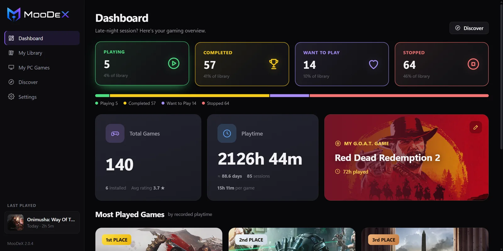
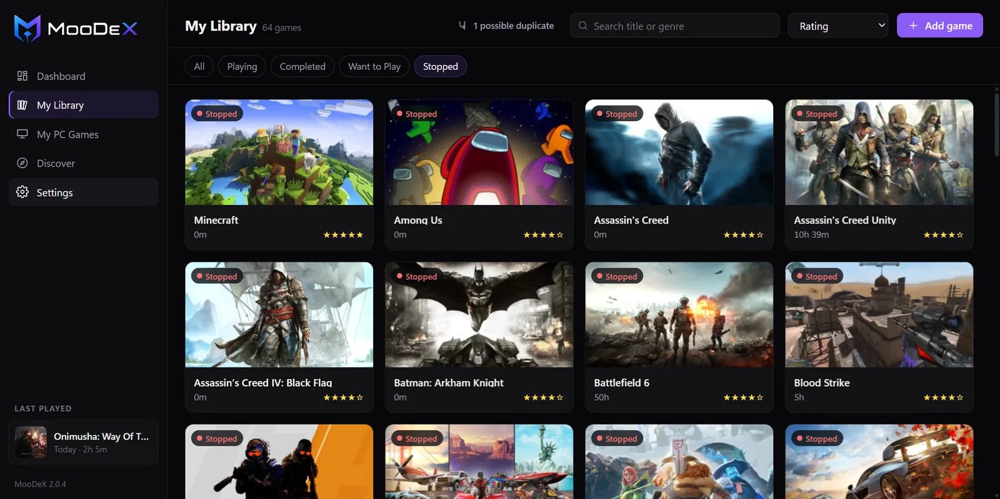
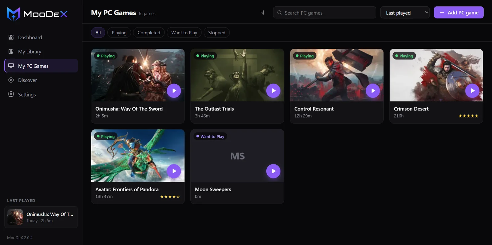
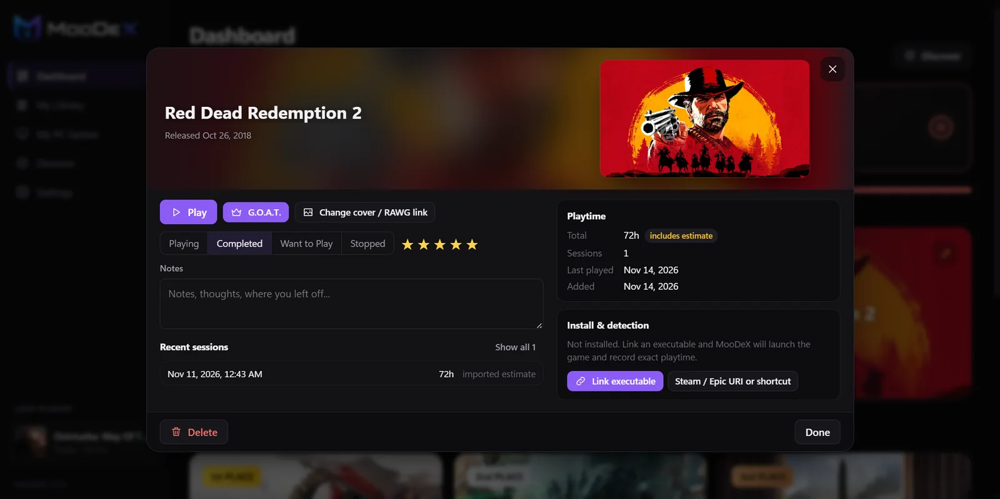
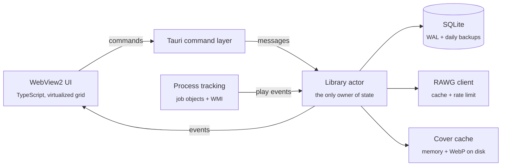

<div align="center">

<picture>
  <source media="(prefers-color-scheme: dark)" srcset="assets/logo-wordmark.png">
  
</picture>

### Every game you own. Every hour you actually played.

A fast, private game library for Windows. Keep every PC game in one list, track playtime that is measured instead of guessed, and let new installs show up on their own.

[](https://github.com/InoshMatheesha/MooDeX/releases/latest)
[](https://github.com/InoshMatheesha/MooDeX/releases)
[](#install)
[](#build-from-source)

<br>

[](https://github.com/InoshMatheesha/MooDeX/releases/latest)
&nbsp;
[](https://moodex-web.vercel.app)

<br>



</div>

<br>

## Highlights

<table>
  <tr>
    <td width="33%" valign="top">
      <h3>Real playtime</h3>
      Steam and Epic launchers quit seconds after starting a game. MooDeX follows the hand-off to the real game and keeps counting until it closes, so a four-hour evening counts as four hours.
    </td>
    <td width="33%" valign="top">
      <h3>Finds your games</h3>
      Point it at the folders your games install into, Steam libraries included. It picks each game's real executable, matches the cover, and adds new installs automatically.
    </td>
    <td width="33%" valign="top">
      <h3>Stays on your PC</h3>
      No account, no telemetry. Your library is one crash-safe database on your PC with daily backups. Updates install in one click and are signature-checked first.
    </td>
  </tr>
</table>

## Features

| | |
|---|---|
| **Library** | All your games in one list with covers, a status (Playing, Completed, Want to Play, Stopped), 1-5 star ratings and notes. Search, filter and sort instantly, even with hundreds of games. |
| **Playtime** | Every session is saved separately and the total is added up from them. Matching uses exact executable paths, so an overlay or a similarly named program is never counted as your game. Time the PC spent asleep isn't counted, and a crash doesn't lose your time. |
| **PC Games** | Installed games get a Play button right on the card. Launch from MooDeX or anywhere else; the session is recorded either way. |
| **Auto-detect** | Watch your game folders. Installers, redistributables and crash reporters are skipped. Games you remove are not re-added. |
| **Dashboard** | Status counts, total hours, your G.O.A.T. game, a most-played podium and a live "Playing now" panel. |
| **Discover** | Browse Trending, Upcoming and Popular games, or search 800k+ games from the RAWG catalogue. Results are cached, so Discover still works offline. |
| **Updates** | Check for updates in Settings. Each download is signature-verified before it installs. |
| **Moving from v1** | Import your MooDeX 1 library with its playtime. You review everything first, and nothing is merged silently. |

## How playtime is measured

```mermaid
gantt
    title One evening of play, as each tracker sees it
    dateFormat HH:mm
    axisFormat %H:%M
    section What runs
    Steam launcher exits in seconds     :done, a1, 20:00, 1m
    The game itself                     :active, a2, 20:01, 251m
    section What gets recorded
    MooDeX session                      :b1, 20:00, 252m
    A typical tracker                   :crit, b2, 20:00, 1m
```



1. When you press **Play**, MooDeX starts the game inside a Windows *job object*. The OS reports when every process in that tree has exited.
2. If the launched program is a launcher stub that exits quickly, MooDeX keeps the session open. It switches to watching the game's real executable, matched by its full path.
3. Games started outside MooDeX (from Steam, a shortcut or anywhere else) are detected the same way, by exact path.
4. A heartbeat every 30 seconds records that the game is still running. If the PC sleeps, the session is split so the time asleep isn't counted. If MooDeX itself is killed, the session ends at the last heartbeat on the next start.

## Screenshots

<table>
  <tr>
    <td></td>
    <td></td>
  </tr>
  <tr>
    <td align="center"><sub><b>Library:</b> every game, one list</sub></td>
    <td align="center"><sub><b>PC Games:</b> play straight from the card</sub></td>
  </tr>
  <tr>
    <td></td>
    <td></td>
  </tr>
  <tr>
    <td align="center"><sub><b>Game details:</b> sessions, rating, notes, launch settings</sub></td>
    <td align="center"><sub><b>Dashboard:</b> your library at a glance</sub></td>
  </tr>
</table>

## Install

1. Download **`MooDeX_<version>_x64-setup.exe`** from the [latest release](https://github.com/InoshMatheesha/MooDeX/releases/latest).
2. Run it. It installs for your user account only, so there is no admin prompt.
3. Optional: in **Settings > Auto-detect games**, add the folders your games install into.

**Requirements:**
- Windows 10 or 11, 64-bit.
- The Microsoft Edge WebView2 Runtime. It ships with Windows 11 and is on most Windows 10 PCs; if it's missing, the installer downloads it.

> [!NOTE]
> **About the "Windows protected your PC" warning:** the installer is not yet signed with a paid code-signing certificate, so SmartScreen doesn't recognise it. Choose **More info**, then **Run anyway**. Every release publishes its SHA-256 checksums.

## Updates

MooDeX updates itself from GitHub Releases:

1. Open **Settings > Updates** and click **Check for updates**.
2. If a newer version is out, click **Download & install**. The package's signature is verified against a key built into the app, then it installs and restarts.

MooDeX can also check quietly at startup; you can turn that off in the same section.

## Your data

| | |
|---|---|
| Library | `%LOCALAPPDATA%\MooDeX\v2\moodex.db` (SQLite, crash-safe) |
| Backups | `%LOCALAPPDATA%\MooDeX\v2\backups`, one per day, the last 7 kept |
| Covers | `%LOCALAPPDATA%\MooDeX\v2\covers`, cached WebP images |
| Logs | `%LOCALAPPDATA%\MooDeX\v2\logs`, kept for 7 days |
| Network | Cover downloads, catalogue lookups and update checks only |
| Telemetry | None |

Uninstalling keeps your library. If you tick **Delete the application data**, your database is copied to `Documents\MooDeX backup` first.

<details>
<summary><b>Discover and the RAWG API key</b></summary>
<br>

Covers and game details come from the [RAWG](https://rawg.io) catalogue. No key is built into the app. Choose one of these in **Settings > Discover**:

- **Personal key:** paste a free key from [rawg.io/apidocs](https://rawg.io/apidocs). It is stored in Windows Credential Manager, never in a file.
- **Proxy:** deploy [`proxy/`](proxy/README.md) to Vercel with your key, then paste its URL into Settings.

Your library works fully without a key; only Discover needs one.
</details>

## FAQ

<details>
<summary><b>Does it track games I start from Steam or Epic directly?</b></summary>
<br>
Yes. Linked games are recognised by their exact executable path however they are started, and MooDeX records the session.
</details>

<details>
<summary><b>I used MooDeX 1. Do I keep my playtime?</b></summary>
<br>
Yes. Go to <b>Settings > Import from MooDeX v1</b>. You see the plan before anything is written, your old file is backed up first, and the playtime is imported as an estimated session.
</details>

<details>
<summary><b>Will it slow down my games?</b></summary>
<br>
No. It doesn't inject anything into games, has no overlay, and sits idle in the tray. Detection uses Windows process events, with a lightweight fallback if those are unavailable.
</details>

<details>
<summary><b>Can I move my library to another PC?</b></summary>
<br>
Yes. Use <b>Settings > Your data > Export library</b> and import the file on the other PC.
</details>

## Build from source

**Prerequisites:**
- Rust, pinned in [`rust-toolchain.toml`](rust-toolchain.toml).
- Node 20 or later.
- A C compiler: MSVC Build Tools, or MSYS2 MinGW-w64 on the GNU toolchain.

```powershell
git clone https://github.com/InoshMatheesha/MooDeX.git
cd MooDeX

# Release build: MooDeX.exe plus the NSIS and MSI installers
powershell -ExecutionPolicy Bypass -File scripts\build.ps1

# The same quality gates CI runs
cargo fmt --all -- --check
cargo clippy --workspace --all-targets -- -D warnings
cargo test --workspace
```

### Architecture



| Crate | Responsibility |
|---|---|
| `moodex-core` | Domain types and pure logic, with no I/O. Fully unit-tested. |
| `moodex-store` | SQLite, migrations, crash-safe writes, backups. |
| `moodex-library` | The library actor, play tracker, folder scanner and v1 import. |
| `moodex-winproc` | Job objects, WMI process events and launching. The only crate that uses `unsafe`. |
| `moodex-rawg` | RAWG client with stale-while-revalidate caching. |
| `moodex-images` | Two-tier cover cache and WebP thumbnails. |
| `app/` | Tauri shell, IPC commands and the TypeScript UI. |
| `site/` | The website at [moodex-web.vercel.app](https://moodex-web.vercel.app). |

<details>
<summary><b>Publishing a release (maintainers)</b></summary>
<br>

1. Bump `version` in `app/src-tauri/tauri.conf.json`, `Cargo.toml` and `app/package.json`, and add a `## <version>` section to `CHANGELOG.md`.
2. Run `scripts\build.ps1`. It signs the update packages with `%USERPROFILE%\.tauri\moodex.key` and writes `target\release\bundle\latest.json`.
3. Create the release `v<version>`. Attach the `-setup.exe`, the `.msi`, both `.sig` files and `latest.json`.

The website and installed apps both pick up the new version from the release automatically.

Release notes written as `- **Headline.** Details` become the changelog cards on the website.
</details>

<br>

<div align="center">

Crafted by **[MoOdY69](https://github.com/InoshMatheesha)**

<sub>Game artwork in screenshots comes from the RAWG catalogue. Windows is a trademark of Microsoft.</sub>

</div>
